<a href="https://djason-chery.dev" title="Ouvrir mon site djason-chery.dev">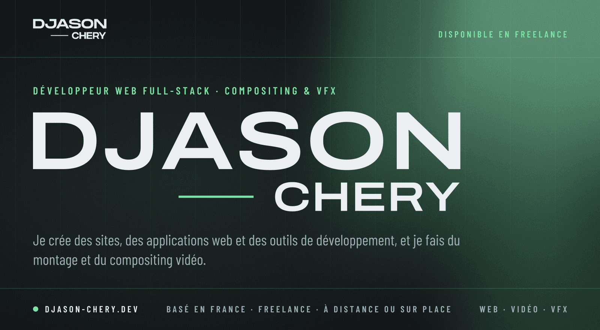</a>

  

  <a href="README.md" title="Read this profile in English">🇬🇧 English version</a>

  
  
  
  
  
  
  
  

 

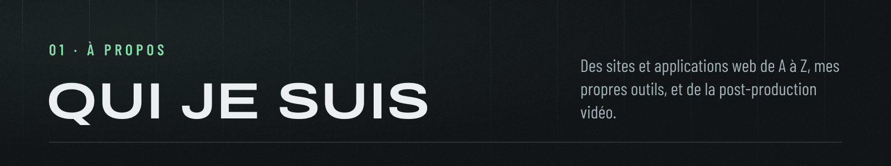

- 💻 Je réalise des **sites et applications web** de A à Z : design, front, API, base de données, paiements, SEO et hébergement
- 🧰 J'ai créé **[DC Scaffold](https://tools.djason-chery.dev/fr/scaffold/ "DC Scaffold sur le site des outils DC")**, un outil qui génère en quelques minutes un projet web complet avec le front et le back end de ton choix, sur Windows, macOS et Linux
- 📨 Et **[DC Prospect](https://tools.djason-chery.dev/fr/prospect/ "DC Prospect sur le site des outils DC")**, une application de bureau qui trouve des entreprises locales et fait ma prospection par e-mail, écrite par une IA intégrée et envoyée seulement après mon accord
- 🛡️ Et enfin **[DC Sentinel](https://tools.djason-chery.dev/fr/sentinel/ "DC Sentinel sur le site des outils DC")**, une application de bureau qui surveille mes sites et sauvegarde leurs bases de données chaque semaine, même ordinateur éteint ; les trois sont gratuits avec une offre Pro, sur **[tools.djason-chery.dev](https://tools.djason-chery.dev/fr/ "Les outils DC")**
- 🎬 Je travaille aussi en **post-production audiovisuelle** : montage, compositing, effets visuels, motion design
- 📫 Disponible pour des missions freelance : **[contact@djason-chery.dev](mailto:contact@djason-chery.dev "M'envoyer un e-mail")**

 

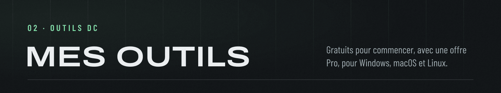

Les trois sont gratuits pour commencer, avec une offre Pro sur **[tools.djason-chery.dev](https://tools.djason-chery.dev/fr/ "Les outils DC")** ; les installateurs pour Windows, macOS et Linux sont dans **[dc-releases](https://github.com/Djason16/dc-releases/releases "Les installateurs des outils DC")**.

<table>
<!-- DC Scaffold -->
<tr>
<td width="96" align="center" valign="top"><a href="https://tools.djason-chery.dev/fr/scaffold/" title="DC Scaffold sur le site des outils DC">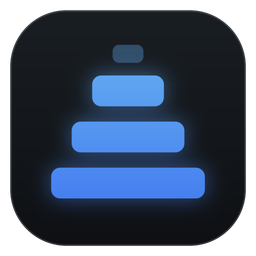</a></td>
<td valign="top">
 
<b>Créateur de projets web</b>

Application de bureau pour Windows, macOS et Linux qui crée un projet web prêt à coder : 11 fronts (ou API seule), 9 back ends dont l'API dans le site, ou aucun back end, MySQL ou SQLite. Elle installe ce qui manque, relie tout et documente chaque fichier.

</td>
</tr>
<!-- DC Prospect -->
<tr>
<td width="96" align="center" valign="top"><a href="https://tools.djason-chery.dev/fr/prospect/" title="DC Prospect sur le site des outils DC">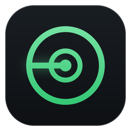</a></td>
<td valign="top">
 
<b>La prospection par e-mail, faite à votre place</b>

Application de bureau pour Windows, macOS et Linux qui fait la prospection par e-mail des indépendants et petites entreprises : elle trouve des entreprises locales, vérifie leur site, écrit chaque e-mail avec une IA intégrée gratuite (ou Gemini, Claude, une clé d'API, ou sans IA), l'envoie au bon moment une fois validé, relance et lit les réponses.

</td>
</tr>
<!-- DC Sentinel -->
<tr>
<td width="96" align="center" valign="top"></td>
<td valign="top">
 
<b>Veille et sauvegarde</b>

Application de bureau pour Windows, macOS et Linux qui surveille des sites web et sauvegarde leurs bases de données, même ordinateur éteint (gratuit jusqu'à 3 sites) : le moteur tourne dans GitHub Actions, dans ton propre dépôt privé, vérifie chaque site, son certificat et son domaine toutes les 2 heures, sauvegarde et chiffre les bases chaque dimanche vers Google Drive, OneDrive, Dropbox ou S3, et prouve chaque mois que la dernière sauvegarde se restaure.

</td>
</tr>
</table>

 

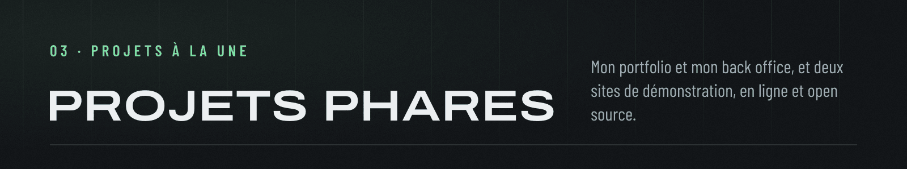

<table>
<!-- DC Portfolio -->
<tr>
<td width="96" align="center" valign="top"><a href="https://djason-chery.dev" title="Ouvrir le site en ligne djason-chery.dev">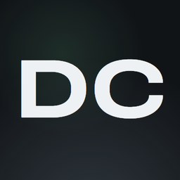</a></td>
<td valign="top">
 
<b>Portfolio + gestion freelance</b>

Mon portfolio et mon outil de gestion freelance dans une seule application : site bilingue optimisé pour le SEO, prise de rendez-vous en ligne, salon visio maison pour les rendez-vous vidéo, espace admin avec clients, missions, devis, factures et contrats en PDF, et paiements Stripe.

</td>
</tr>
<!-- Élan Solidaire -->
<tr>
<td width="96" align="center" valign="top"><a href="https://elan-solidaire.djason-chery.dev" title="Ouvrir la démo en ligne Élan Solidaire">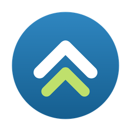</a></td>
<td valign="top">
 
<b>Association humanitaire</b>

Site de démonstration d'une association humanitaire fictive : dons ponctuels et mensuels avec reçu fiscal, adhésion, boutique solidaire avec suivi de commande, agenda avec inscription, espace membre et administration complète. Tout est simulé dans le navigateur.

</td>
</tr>
<!-- Éclat Auto -->
<tr>
<td width="96" align="center" valign="top"></td>
<td valign="top">
 
<b>Lavage et detailing auto</b>

Site de démonstration d'une station de lavage et detailing auto fictive : réservation en ligne en 6 étapes avec de vrais créneaux et paiement simulé, espace client, administration (réservations, calendrier des disponibilités, tarifs), devis pour les professionnels.

</td>
</tr>
</table>

 

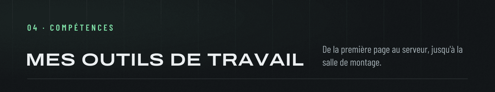

<table>
<tr>
<td width="150" valign="top"><b>FRONT END</b></td>
<td valign="top">
 

</td>
</tr>
<tr>
<td width="150" valign="top"><b>BACK END ET DONNÉES</b></td>
<td valign="top">
 

</td>
</tr>
<tr>
<td width="150" valign="top"><b>OUTILS ET HÉBERGEMENT</b></td>
<td valign="top">
 

</td>
</tr>
<tr>
<td width="150" valign="top"><b>POST-PRODUCTION</b></td>
<td valign="top">
 

</td>
</tr>
</table>

 

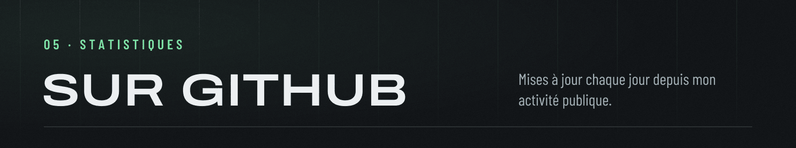

  
  

  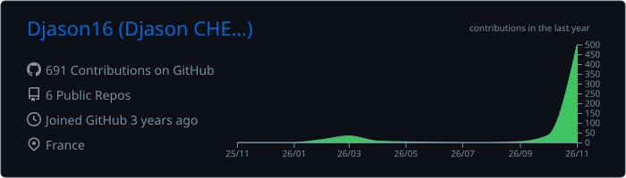

  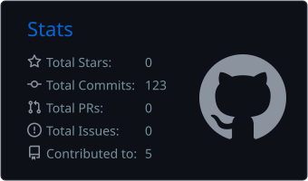
  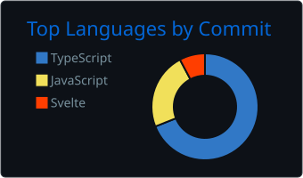

  <picture>
    <source media="(prefers-color-scheme: dark)" srcset="https://raw.githubusercontent.com/Djason16/Djason16/output/snake-dark.svg" />
    <source media="(prefers-color-scheme: light)" srcset="https://raw.githubusercontent.com/Djason16/Djason16/output/snake-light.svg" />
    
  </picture>

 

<a href="mailto:contact@djason-chery.dev" title="M'envoyer un e-mail">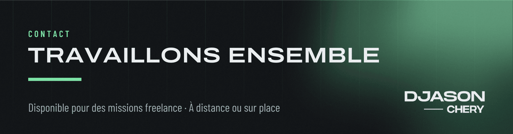</a>

  <a href="https://djason-chery.dev" title="Ouvrir mon site djason-chery.dev"><b>djason-chery.dev</b></a> · <a href="mailto:contact@djason-chery.dev" title="M'envoyer un e-mail">contact@djason-chery.dev</a> · <a href="tel:+33758204726" title="M'appeler">07 58 20 47 26</a>

