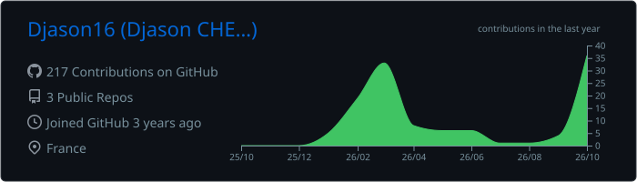
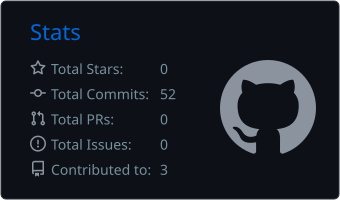
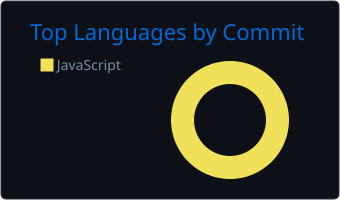

  

<h3 align="center">Full-stack web developer · Compositing & VFX editor</h3>

  I build fast, clean websites, web apps and dev tools, and I edit and composite video. 
  Based in France · Freelance · Remote or on-site

  <a href="README.fr.md">🇫🇷 Version française</a>

  
  
  
  
  

---

## 👋 About me

- 💻 I build **websites and web apps** end to end: design, front end, API, database, payments, SEO and hosting
- 🧰 I made **[DC Scaffold](https://github.com/Djason16/dc-scaffold)**, a tool that creates a complete web project with the front end and back end of your choice in a few minutes
- 🎬 I also work in **audiovisual post-production**: editing, compositing, visual effects, motion design
- 📫 Open to freelance missions: **[contact@djason-chery.dev](mailto:contact@djason-chery.dev)**

---

## 🚀 Featured projects

<table>
  <tr>
    <td width="50%" valign="top">
      <h3><a href="https://github.com/Djason16/dc-scaffold">DC Scaffold</a></h3>
      
Windows app that creates a ready-to-code web project: 12 front ends, 10 back ends, MySQL or SQLite. It installs what is missing, wires everything together and documents every file.

      
      
      
      
    </td>
    <td width="50%" valign="top">
      <h3><a href="https://github.com/Djason16/djason-cv">djason-chery.dev</a></h3>
      
My portfolio and freelance back office in one app: SEO-ready site in French and English, private admin with clients, missions, PDF quotes, invoices and contracts, and Stripe payments.

      
      
      
      
    </td>
  </tr>
</table>

---

## 🛠️ Tech stack

**Front end**

  
  
  
  
  
  
  
  
  
  
  
  
  
  
  
  
  

**Back end & data**

  
  
  
  
  
  
  
  
  
  
  
  

**Tools & hosting**

  
  
  
  
  
  
  
  
  

**Post-production**

  
  
  
  
  
  
  

---

## 📊 GitHub stats

  
  

  

  
  

---

  <a href="https://djason-chery.dev"><b>djason-chery.dev</b></a> · <a href="mailto:contact@djason-chery.dev">contact@djason-chery.dev</a> · <a href="tel:+33758204726">07 58 20 47 26</a>

