<a href="https://djason-chery.dev" title="Open my website djason-chery.dev">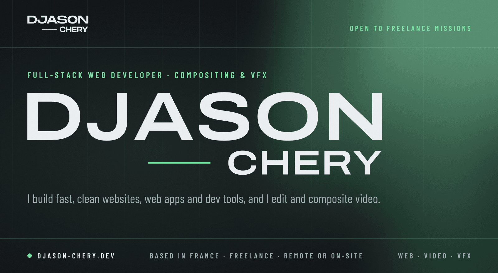</a>

  

  <a href="README.fr.md" title="Lire ce profil en français">🇫🇷 Version française</a>

  
  
  
  
  
  
  
  

  
  
  
  

 

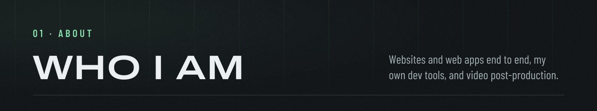

- 💻 I build **websites and web apps** end to end: design, front end, API, database, payments, SEO and hosting
- 🧰 I made **[DC Scaffold](https://tools.djason-chery.dev/en/scaffold/ "DC Scaffold on the DC Tools site")**, a tool that creates a complete web project with the front end and back end of your choice in a few minutes, on Windows, macOS and Linux
- 📨 And **[DC Prospect](https://tools.djason-chery.dev/en/prospect/ "DC Prospect on the DC Tools site")**, a desktop app that finds local businesses and runs my e-mail prospecting, written by a built-in AI and sent only after my approval
- 🛡️ Plus **[DC Sentinel](https://tools.djason-chery.dev/en/sentinel/ "DC Sentinel on the DC Tools site")**, a desktop app that watches my websites and backs up their databases every week, even with my computer off
- 🔍 And **[DC Audit](https://tools.djason-chery.dev/en/audit/ "DC Audit on the DC Tools site")**, a desktop app that audits any website in a few minutes (speed, SEO, accessibility, security, French legal duties) and runs my own checklist before each release; all four are free with a Pro plan, on **[tools.djason-chery.dev](https://tools.djason-chery.dev/en/ "The DC tools")**
- 🎬 I also work in **audiovisual post-production**: editing, compositing, visual effects, motion design
- 📫 Open to freelance missions: **[contact@djason-chery.dev](mailto:contact@djason-chery.dev "Send me an e-mail")**

 

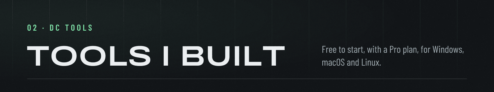

All four are free to start, with a Pro plan on **[tools.djason-chery.dev](https://tools.djason-chery.dev/en/ "The DC tools")**; the installers for Windows, macOS and Linux are in **[dc-releases](https://github.com/Djason16/dc-releases/releases "The installers of the DC tools")**.

<table>
<!-- DC Scaffold -->
<tr>
<td width="96" align="center" valign="top"><a href="https://tools.djason-chery.dev/en/scaffold/" title="DC Scaffold on the DC Tools site">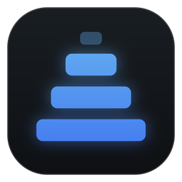</a></td>
<td valign="top">
 
<b>Web project creator</b>

Desktop app for Windows, macOS and Linux that creates a ready-to-code web project: 11 front ends (or API only), 9 back ends including the API inside the site, or no back end at all, MySQL or SQLite. It installs what is missing, wires everything together and documents every file.

</td>
</tr>
<!-- DC Prospect -->
<tr>
<td width="96" align="center" valign="top"><a href="https://tools.djason-chery.dev/en/prospect/" title="DC Prospect on the DC Tools site">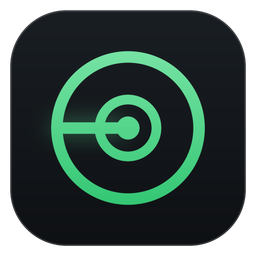</a></td>
<td valign="top">
 
<b>E-mail prospecting, done for you</b>

Desktop app for Windows, macOS and Linux that does e-mail prospecting for freelancers and small businesses: it finds local businesses, checks their website, writes each e-mail with a free built-in AI (or Gemini, Claude, an API key, or no AI at all), sends it at the right time once approved, follows up and reads the replies.

</td>
</tr>
<!-- DC Sentinel -->
<tr>
<td width="96" align="center" valign="top"></td>
<td valign="top">
 
<b>Watch and backup</b>

Desktop app for Windows, macOS and Linux that watches websites and backs up their databases, even with the computer off (free up to 3 sites): the engine runs in GitHub Actions in your own private repository, checks every site, its certificate and its domain every 2 hours, backs up and encrypts the databases every Sunday to Google Drive, OneDrive, Dropbox or S3, and proves every month that the newest backup can be restored.

</td>
</tr>
<!-- DC Audit -->
<tr>
<td width="96" align="center" valign="top"><a href="https://tools.djason-chery.dev/en/audit/" title="DC Audit on the DC Tools site">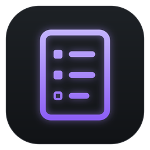</a></td>
<td valign="top">
 
<b>Website audit and checklist</b>

Desktop app for Windows, macOS and Linux that audits any website in a few minutes (free: 5 audits a month): speed, search, accessibility, security and French legal duties, tested from outside in the Chromium built into the app (Lighthouse, axe-core), then your own checklist before going live, with a clear PDF report under your brand, competitors compared and the scores followed over time.

</td>
</tr>
</table>

 

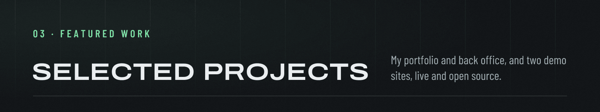

<table>
<!-- DC Portfolio -->
<tr>
<td width="96" align="center" valign="top"><a href="https://djason-chery.dev" title="Open the live site djason-chery.dev">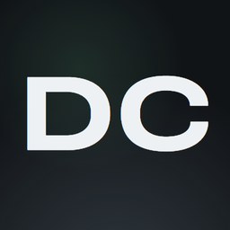</a></td>
<td valign="top">
 
<b>Portfolio + freelance back office</b>

My portfolio and freelance back office in one app: SEO-ready site in French and English, online appointment booking, in-house video room for video calls, private admin with clients, missions, PDF quotes, invoices and contracts, and Stripe payments.

</td>
</tr>
<!-- Élan Solidaire -->
<tr>
<td width="96" align="center" valign="top"><a href="https://elan-solidaire.djason-chery.dev" title="Open the live demo Élan Solidaire">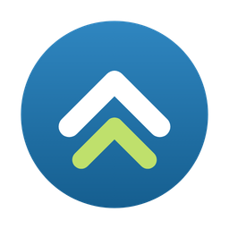</a></td>
<td valign="top">
 
<b>Humanitarian association</b>

Demo website of a fictional humanitarian association: donations (one-off and monthly, tax receipt), membership, charity shop with order tracking, events with sign-up, member area and full admin. Everything is simulated in the browser.

</td>
</tr>
<!-- Éclat Auto -->
<tr>
<td width="96" align="center" valign="top"></td>
<td valign="top">
 
<b>Car wash and detailing</b>

Demo website of a fictional car wash and detailing business: 6-step online booking with real free slots and simulated payment, customer account, admin with bookings, availability calendar and prices, quote form for professionals.

</td>
</tr>
</table>

 

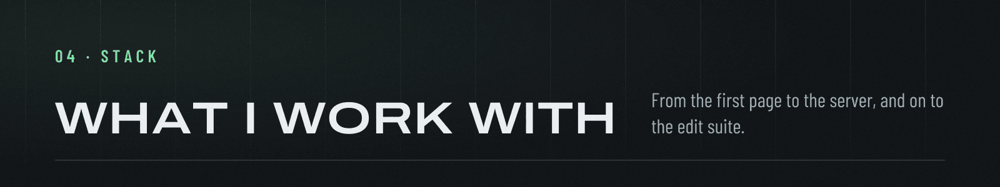

<table>
<tr>
<td width="150" valign="top"><b>FRONT END</b></td>
<td valign="top">
 

</td>
</tr>
<tr>
<td width="150" valign="top"><b>BACK END &AMP; DATA</b></td>
<td valign="top">
 

</td>
</tr>
<tr>
<td width="150" valign="top"><b>TOOLS &AMP; HOSTING</b></td>
<td valign="top">
 

</td>
</tr>
<tr>
<td width="150" valign="top"><b>POST-PRODUCTION</b></td>
<td valign="top">
 

</td>
</tr>
</table>

 

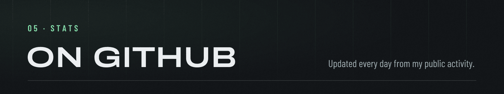

  
  

  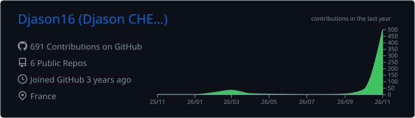

  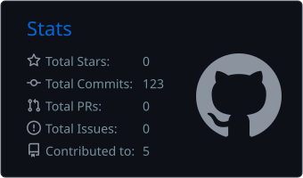
  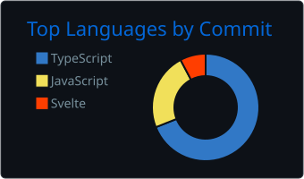

  <picture>
    <source media="(prefers-color-scheme: dark)" srcset="https://raw.githubusercontent.com/Djason16/Djason16/output/snake-dark.svg" />
    <source media="(prefers-color-scheme: light)" srcset="https://raw.githubusercontent.com/Djason16/Djason16/output/snake-light.svg" />
    
  </picture>

 

<a href="mailto:contact@djason-chery.dev" title="Send me an e-mail">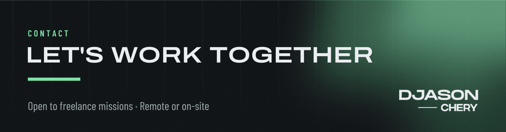</a>

  <a href="https://djason-chery.dev" title="Open my website djason-chery.dev"><b>djason-chery.dev</b></a> · <a href="mailto:contact@djason-chery.dev" title="Send me an e-mail">contact@djason-chery.dev</a> · <a href="tel:+33758204726" title="Call me">07 58 20 47 26</a>

